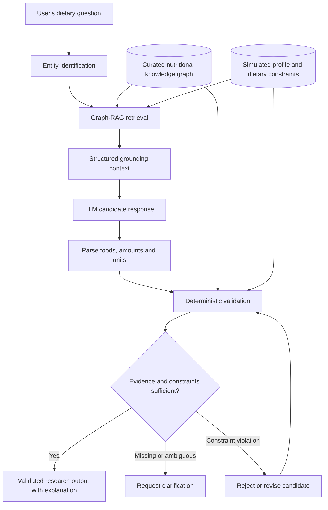

# Safety-Aware Graph-RAG for Phenylketonuria Dietary Management

**Research in progress | Large Language Models | Graph-RAG | Knowledge Graphs | Deterministic Validation | Responsible AI**

> **Status:** Working research project. Manuscript and experimental evaluation are not finalized. This repository is a technical research overview, not a validated healthcare application.

## Overview

This project investigates a **safety-aware, graph-grounded LLM architecture** for answering dietary questions in phenylketonuria (PKU), a metabolic condition requiring careful management of phenylalanine intake.

The central engineering question is how to combine the language flexibility of an LLM with **structured evidence and non-negotiable numerical constraints**. In the proposed design, an LLM prepares a candidate response, but it **does not have final authority over nutritional calculations or safety decisions**. Those checks belong to a separate deterministic validation component.

**Research scope:** An experimental decision-support architecture evaluated using synthetic scenarios. It is not a clinical product and must not be used to guide patient care.

## Proposed Architecture

*Conceptual architecture from the working manuscript. An output is shown as validated only after independent checking of retrieved nutrient values, portion units, and applicable constraints.*

## Core Components

### 1. Structured PKU Knowledge Graph

The proposed knowledge graph represents relationships among foods, nutrient values, medical formulas, dietary constraints, and user profiles. Its purpose is to supply **traceable evidence**, not to delegate clinical judgment to an LLM.

### 2. Graph-Based Retrieval-Augmented Generation

A retrieval stage identifies relevant entities, follows bounded graph relationships, and assembles structured grounding context. The draft describes entity linking, neighborhood retrieval, and selection of constraints relevant to a simulated profile.

### 3. LLM Candidate Generation

The language model uses the retrieved evidence to form a candidate explanation or food/portion proposal. The LLM's numerical output is treated as **untrusted until independently checked**.

### 4. Deterministic Constraint Validation

A separate validator is designed to normalize portion units, recompute nutrient quantities from source values, evaluate profile-specific limits, and reject or clarify candidates when values are missing, ambiguous, or outside allowed constraints. Any revised proposal requires another validation pass.

## Research Questions

- Can graph-grounded retrieval improve the traceability of evidence in an LLM-assisted nutrition workflow?
- Can deterministic checking identify or prevent constraint violations that would be missed by unvalidated generation?
- How should the system respond when food quantities, units, or relevant evidence are incomplete?
- How should correctness be evaluated separately for retrieval, numerical calculations, constraint compliance, and explanation quality?

## Evaluation Plan and Current Status

The working manuscript describes a synthetic-scenario evaluation comparing three architectures:

1. A rule-based calculator without conversational generation.
2. An LLM without graph grounding or final-rule validation.
3. A proposed LLM + Graph-RAG + deterministic validation pipeline.

Its evaluation framework discusses precision, recall, F1, portion error, and a proposed **Dietary Safety Adherence Score (DSAS)** measuring both phenylalanine-limit compliance and portion-level deviation from reference calculations.

**All quantitative findings are considered preliminary and are intentionally omitted from this README** until the study design, code, data provenance, calculations, and reproducibility checks are finalized. No clinical efficacy, real-world safety, or deployment-readiness claim is made.

## Technical Skills Demonstrated

- LLM application architecture and structured prompting
- Retrieval-augmented generation with graph-structured evidence
- Knowledge graph modeling and retrieval workflows
- Deterministic rule engines and independent calculation checks
- Fail-safe behavior, input validation, and unit normalization
- Benchmark design and evaluation of safety-related failures
- Responsible AI and human-in-the-loop system design

*Specific frameworks, model identifiers, libraries, and implementation artifacts will be listed only after they have been verified against the research code and execution records.*

## Relationship to Other Research

This project is distinct from the [PKU Safety-Constrained Recommender](https://github.com/malihealiasgari20/PKU-Safety-Constrained-Recommender), which studies collaborative/content-based recommendation, cuisine-aware filtering, and preference ranking. This project focuses instead on **conversational LLM outputs, graph-based evidence retrieval, and independent validation of generated recommendations**.

## Disclosure and Research Integrity

The original codebase, knowledge graph, synthetic profiles, experimental logs, working manuscript, and research figures are **not included** in this portfolio overview. Public release of additional artifacts will depend on research completion, collaborator approval, and applicable rights or restrictions.

This repository is not a substitute for metabolic specialist advice and does not provide individualized dietary recommendations.

## Research Contact

**Malihe Aliasgari, Ph.D.**  
[Research website](https://malihealiasgari20.github.io/) | [GitHub profile](https://github.com/malihealiasgari20)

*Manuscript author list, final title, venue, and publication status will be added once confirmed.*
